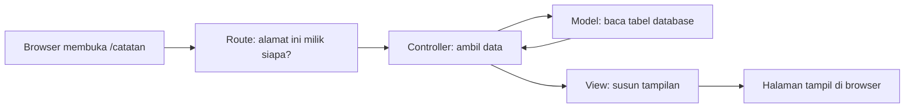

### Baca Ini Dulu: Peta Belajar untuk Pemula <!-- id: modul-pertama-peta; icon: fas fa-map-signs; short: Peta Belajar Pemula; keywords: pemula, awam, mulai dari mana, tutorial, belajar -->

Bab ini ditulis untuk Anda yang **baru pertama kali** memakai template ini. Anda tidak perlu sudah mahir Laravel. Cukup pernah menulis sedikit kode (PHP atau bahasa lain) dan bisa membuka terminal.

Di akhir bab ini Anda akan punya **fitur Catatan** yang sudah jalan, yaitu halaman untuk melihat, menambah, mengubah, dan menghapus catatan. Fitur seperti ini disebut **CRUD** (*Create, Read, Update, Delete*). Hampir semua aplikasi kampus berisi kumpulan CRUD, jadi inilah latihan paling berguna untuk memulai.

**Urutan belajar yang disarankan:**

| Urutan | Yang dikerjakan | Lama | Tempatnya |
|---|---|---|---|
| 1 | Pasang aplikasi sampai bisa login | 30 menit | Bab *Mulai dari Sini*, bagian [Instalasi Pertama Kali](#mulai-instalasi) |
| 2 | **Buat fitur pertama (bab ini)** | 45 menit | Anda di sini |
| 3 | Pelajari cara standar TSU (hak akses, menu, tampilan seragam) | 1 sampai 2 jam | Bab *Tutorial CRUD Standar TSU* |
| 4 | Periksa pekerjaan sebelum diserahkan | 15 menit | Bab *Checklist Evaluasi* di bagian paling bawah |

> **Tenang soal kesalahan.** Pesan error itu normal dan bagian dari belajar. Di bagian [Kalau Ada Error](#modul-pertama-error) ada daftar error yang paling sering muncul beserta cara memperbaikinya.

Bab ini sengaja memakai cara paling sederhana, yaitu Laravel biasa tanpa fitur khusus TSU. Tujuannya agar Anda paham dulu kerangkanya. Setelah itu, bab *Tutorial CRUD Standar TSU* menunjukkan cara membuat fitur yang sama dengan standar TSU yang lengkap.

---

### Istilah yang Akan Anda Temui <!-- id: modul-pertama-istilah; icon: fas fa-language; short: Kamus Istilah; keywords: istilah, glosarium, artinya, apa itu -->

Anda tidak perlu menghafal. Kembali ke tabel ini kapan saja ada istilah yang membingungkan.

| Istilah | Artinya dalam bahasa sehari-hari |
|---|---|
| **Laravel** | Kerangka kerja (*framework*) PHP. Ia menyediakan fondasi aplikasi, jadi Anda tidak mulai dari nol. |
| **Modul** | Satu "kotak" berisi satu fitur lengkap (tabel, halaman, aturan). Setiap fitur punya kotaknya sendiri di folder `Modules/`. |
| **Terminal** | Jendela hitam tempat mengetik perintah. Di Laragon: klik kanan ikon Laragon, pilih *Terminal*. |
| **Artisan** | Alat bantu bawaan Laravel. Dipakai lewat perintah yang diawali `php artisan`. |
| **Migration** | "Resep" untuk membuat atau mengubah tabel database lewat kode, sehingga seluruh tim punya tabel yang sama. |
| **Model** | Kode PHP yang mewakili satu tabel. Lewat model, Anda menyimpan dan membaca data tanpa menulis SQL. |
| **Route** | Daftar alamat (URL) dan tujuannya. Contoh: alamat `/catatan` diarahkan ke daftar catatan. |
| **Controller** | Pengatur lalu lintas. Ia menerima permintaan dari browser, mengambil data lewat model, lalu memilih tampilan. |
| **View** | Berkas tampilan (HTML) yang dilihat pengguna. Berekstensi `.blade.php`. |
| **Blade** | Cara menulis view: HTML biasa ditambah perintah khusus seperti `@foreach` dan `{{ }}`. |
| **Layout** | Bingkai halaman (menu samping, bar atas, footer). Disediakan paket `tsu-core`, jadi Anda tinggal mengisi bagian tengah. |

**Alur sederhana saat pengguna membuka halaman:**



Ingat alur ini. Lima langkah pembuatan fitur di bawah mengikuti urutan yang sama.

---

### Persiapan: Pastikan Aplikasi Sudah Jalan <!-- id: modul-pertama-persiapan; icon: fas fa-check-circle; short: Persiapan; keywords: persiapan, prasyarat, terminal, login -->

Sebelum mulai, pastikan tiga hal ini benar. Kalau salah satunya belum, selesaikan dulu lewat bagian [Instalasi Pertama Kali](#mulai-instalasi).

1. **Aplikasi bisa dibuka di browser**, misalnya `http://nama-proyek.test` (atau `http://localhost/nama-proyek`, atau `http://127.0.0.1:8000` bila memakai `php artisan serve`), dan halaman login muncul. Bila yang tampil daftar berkas atau Apache menjawab 404, lihat bagian [Menjalankan Aplikasi di Komputer Lokal](#mulai-server-lokal).
2. **Anda bisa login.** Kalau belum punya akun lokal, jalankan perintah pembuat akun developer pada langkah terakhir instalasi.
3. **Terminal sudah berada di folder `sources`.** Semua perintah `php artisan` di bab ini dijalankan dari folder tersebut.

Cara memeriksa posisi terminal:

```bash
php artisan --version
```

Kalau yang muncul tulisan `Laravel Framework ...`, Anda sudah di tempat yang benar. Kalau muncul pesan *Could not open input file: artisan*, berarti terminal masih di folder yang salah. Pindah dengan `cd` ke folder `sources` milik proyek Anda.

> **Tips editor:** buka seluruh folder proyek di VS Code (*File > Open Folder*), bukan satu berkas saja. Dengan begitu Anda bisa melihat semua folder di panel kiri.

---

### Mengenal Isi Folder Proyek <!-- id: modul-pertama-folder; icon: fas fa-folder-tree; short: Isi Folder Proyek; keywords: folder, struktur, direktori, di mana -->

Anda hanya perlu mengenal beberapa folder di dalam `sources/`:

```text
sources/
├── Modules/            ← TEMPAT ANDA BEKERJA. Satu folder = satu fitur.
│   └── Admin/          ← Contoh modul bawaan (dashboard). Boleh dilihat, jangan diubah.
├── app/                ← Kode umum aplikasi (jarang Anda sentuh)
├── database/           ← Database umum aplikasi
├── resources/          ← Tampilan umum aplikasi
├── routes/             ← Route umum aplikasi
├── .env                ← Pengaturan aplikasi (database, nama aplikasi)
└── vendor/             ← Paket hasil unduhan Composer. JANGAN diubah sama sekali.
```

Aturan emas untuk pemula:

* **Fitur baru selalu dibuat di dalam `Modules/`**, tidak di folder lain.
* **Jangan mengubah isi `vendor/`.** Folder itu ditimpa ulang setiap kali paket diperbarui, sehingga perubahan Anda hilang.
* **Jangan mengubah modul `Admin`** untuk fitur Anda. Buat modul baru. Alasan lengkapnya ada di bagian [Modul Baru vs Modul Admin](#zona-kapan-modul-baru).

Isi satu modul (folder yang akan kita buat sebentar lagi):

```text
Modules/Catatan/
├── Entities/                  ← Model (mewakili tabel)
├── Database/Migrations/       ← Resep pembuatan tabel
├── Http/Controllers/          ← Controller
├── Resources/views/           ← View (tampilan)
├── Routes/web.php             ← Route (daftar alamat)
├── Providers/                 ← Penghubung modul ke aplikasi (otomatis, tidak perlu disentuh)
└── module.json                ← Kartu identitas modul
```

---

### Langkah 1: Membuat Modul Kosong <!-- id: modul-pertama-buat-modul; icon: fas fa-cube; short: Buat Modul; keywords: module:make, module:enable, nwidart, modul baru -->

Kita akan membuat modul bernama **Catatan**. Jalankan di terminal:

```bash
php artisan module:make Catatan
```

Laravel membuat folder `Modules/Catatan` beserta kerangkanya. Nama modul memakai huruf kapital di awal kata, tanpa spasi.

Modul baru masih **mati** secara bawaan. Nyalakan dengan:

```bash
php artisan module:enable Catatan
```

Periksa hasilnya:

```bash
php artisan module:list
```

Baris `Catatan` harus berstatus `[Enabled]`.

> **Kenapa ini penting?** Banyak pemula membuat semua berkas dengan benar tetapi halamannya tetap *404 Not Found*. Penyebab paling umum: modul belum dinyalakan.

---

### Langkah 2: Membuat Tabel Database (Migration) <!-- id: modul-pertama-tabel; icon: fas fa-database; short: Tabel Database; keywords: migration, migrate, tabel, kolom, make-migration -->

Catatan butuh tempat penyimpanan, yaitu satu tabel. Buat berkas migration-nya:

```bash
php artisan module:make-migration create_catatans_table Catatan
```

Perintah ini membuat berkas di `Modules/Catatan/Database/Migrations/` dengan nama berawalan tanggal dan jam. Buka berkas itu, lalu ganti seluruh isinya dengan:

```php
<?php

use Illuminate\Database\Migrations\Migration;
use Illuminate\Database\Schema\Blueprint;
use Illuminate\Support\Facades\Schema;

return new class extends Migration
{
    // up = apa yang dilakukan saat tabel DIBUAT
    public function up(): void
    {
        Schema::create('catatans', function (Blueprint $table) {
            $table->id();                      // kolom nomor urut otomatis
            $table->string('judul');           // teks pendek, wajib ada
            $table->text('isi')->nullable();   // teks panjang, boleh kosong
            $table->timestamps();              // kolom waktu dibuat dan diubah (otomatis)
        });
    }

    // down = apa yang dilakukan saat migration DIBATALKAN
    public function down(): void
    {
        Schema::dropIfExists('catatans');
    }
};
```

Terapkan ke database:

```bash
php artisan migrate
```

Kalau berhasil, muncul baris `... create_catatans_table ... DONE`. Anda bisa membuka database (misalnya lewat HeidiSQL di Laragon) dan melihat tabel `catatans` sudah ada.

> **Aturan nama:** nama tabel memakai bentuk jamak huruf kecil (`catatans`). Ikuti pola ini agar Laravel menemukan tabelnya otomatis.

---

### Langkah 3: Membuat Model <!-- id: modul-pertama-model; icon: fas fa-table; short: Model; keywords: model, eloquent, fillable, entities -->

Model adalah jembatan antara kode dan tabel. Buat dengan:

```bash
php artisan module:make-model Catatan Catatan
```

(Argumen pertama adalah nama model, argumen kedua adalah nama modul. Keduanya kebetulan sama.)

Buka `Modules/Catatan/Entities/Catatan.php`, lalu isi baris `$fillable` seperti ini:

```php
protected $fillable = ['judul', 'isi'];
```

`$fillable` adalah daftar kolom yang **boleh diisi dari formulir**. Kolom yang tidak ada di daftar ini akan ditolak Laravel. Ini perlindungan keamanan, jadi jangan dikosongkan.

---

### Langkah 4: Mendaftarkan Route (Alamat Halaman) <!-- id: modul-pertama-route; icon: fas fa-route; short: Route; keywords: route, url, alamat, web.php, middleware auth -->

Ganti seluruh isi `Modules/Catatan/Routes/web.php` dengan:

```php
<?php

use Illuminate\Support\Facades\Route;
use Modules\Catatan\Http\Controllers\CatatanController;

// Semua halaman catatan hanya untuk pengguna yang sudah login
Route::middleware(['auth'])->prefix('catatan')->name('catatan.')->group(function () {
    Route::get('/', [CatatanController::class, 'index'])->name('index');
    Route::get('/tambah', [CatatanController::class, 'create'])->name('create');
    Route::post('/', [CatatanController::class, 'store'])->name('store');
    Route::get('/{catatan}/ubah', [CatatanController::class, 'edit'])->name('edit');
    Route::put('/{catatan}', [CatatanController::class, 'update'])->name('update');
    Route::delete('/{catatan}', [CatatanController::class, 'destroy'])->name('destroy');
});
```

Cara membacanya: setiap baris berbunyi *"kalau ada permintaan dengan METODE ini ke ALAMAT ini, serahkan ke fungsi ini milik controller"*.

| Alamat | Tujuan |
|---|---|
| `GET /catatan` | Menampilkan daftar catatan |
| `GET /catatan/tambah` | Menampilkan formulir catatan baru |
| `POST /catatan` | Menyimpan catatan baru |
| `GET /catatan/5/ubah` | Menampilkan formulir ubah catatan nomor 5 |
| `PUT /catatan/5` | Menyimpan perubahan catatan nomor 5 |
| `DELETE /catatan/5` | Menghapus catatan nomor 5 |

Bagian `middleware(['auth'])` artinya **wajib login**. Tanpa ini, siapa pun yang tahu alamatnya bisa membuka halaman. Jangan dihapus.

Nama seperti `catatan.index` dipakai nanti di view lewat `route('catatan.index')`. Kita memakai nama, bukan alamat tertulis, agar alamat bisa diganti tanpa mengubah banyak berkas.

---

### Langkah 5: Membuat Controller <!-- id: modul-pertama-controller; icon: fas fa-shield-alt; short: Controller; keywords: controller, store, update, destroy, validasi, validate -->

Generator sudah membuat berkas controller kosong. Ganti seluruh isi `Modules/Catatan/Http/Controllers/CatatanController.php` dengan:

```php
<?php

namespace Modules\Catatan\Http\Controllers;

use App\Http\Controllers\Controller;
use Illuminate\Http\Request;
use Modules\Catatan\Entities\Catatan;

class CatatanController extends Controller
{
    // Daftar semua catatan
    public function index()
    {
        $catatans = Catatan::latest()->get();

        return view('catatan::index', compact('catatans'));
    }

    // Halaman formulir catatan baru
    public function create()
    {
        return view('catatan::form', ['catatan' => new Catatan()]);
    }

    // Menyimpan catatan baru
    public function store(Request $request)
    {
        Catatan::create($this->validated($request));

        return redirect()->route('catatan.index')->with('success', 'Catatan berhasil disimpan.');
    }

    // Halaman formulir ubah catatan
    public function edit(Catatan $catatan)
    {
        return view('catatan::form', compact('catatan'));
    }

    // Menyimpan perubahan catatan
    public function update(Request $request, Catatan $catatan)
    {
        $catatan->update($this->validated($request));

        return redirect()->route('catatan.index')->with('success', 'Catatan berhasil diubah.');
    }

    // Menghapus catatan
    public function destroy(Catatan $catatan)
    {
        $catatan->delete();

        return redirect()->route('catatan.index')->with('success', 'Catatan berhasil dihapus.');
    }

    // Aturan isian: judul wajib diisi, isi boleh kosong
    private function validated(Request $request): array
    {
        return $request->validate([
            'judul' => ['required', 'string', 'max:150'],
            'isi'   => ['nullable', 'string'],
        ]);
    }
}
```

Hal-hal yang perlu dipahami:

* **Satu fungsi, satu tugas.** `index` menampilkan daftar, `store` menyimpan, dan seterusnya.
* **`validate` adalah penjaga pintu.** Kalau judul kosong atau lebih dari 150 huruf, Laravel otomatis mengembalikan pengguna ke formulir lengkap dengan pesan kesalahan. Data tidak masuk database.
* **`view('catatan::index')`** artinya "pakai berkas `index.blade.php` milik modul `catatan`". Tanda `::` memisahkan nama modul dan nama berkas.
* **`Catatan $catatan` pada fungsi `edit`, `update`, `destroy`** membuat Laravel mencari catatan berdasarkan nomor di alamat. Kalau nomornya tidak ada, pengguna otomatis melihat halaman 404.

---

### Langkah 6: Membuat Tampilan (View) <!-- id: modul-pertama-tampilan; icon: fas fa-palette; short: Tampilan; keywords: view, blade, layout, extends, tsu-core, form, tabel -->

Kita butuh dua tampilan: **daftar** (`index`) dan **formulir** (`form`, dipakai untuk tambah dan ubah). Keduanya berada di `Modules/Catatan/Resources/views/`.

Pertama, ganti isi `index.blade.php` dengan:

```blade
@extends('tsu-core::template.admin.header')
@section('title', 'Catatan')

@section('content')
    <x-tsu-page-header title="Catatan" icon="fas fa-sticky-note" :breadcrumb="true">
        <x-slot name="actions">
            <a href="{{ route('catatan.create') }}" class="btn btn-sm btn-primary">
                <i class="fas fa-plus me-1"></i> Tambah Catatan
            </a>
        </x-slot>
    </x-tsu-page-header>

    <section class="app-content">
        <div class="container-fluid">
            @if (session('success'))
                <div class="alert alert-success">{{ session('success') }}</div>
            @endif

            <div class="card">
                <div class="card-body">
                    <table class="table table-hover align-middle">
                        <thead>
                            <tr>
                                <th>Judul</th>
                                <th>Isi</th>
                                <th class="text-end">Aksi</th>
                            </tr>
                        </thead>
                        <tbody>
                            @forelse ($catatans as $catatan)
                                <tr>
                                    <td>{{ $catatan->judul }}</td>
                                    <td>{{ \Illuminate\Support\Str::limit($catatan->isi, 80) }}</td>
                                    <td class="text-end">
                                        <a href="{{ route('catatan.edit', $catatan) }}" class="btn btn-sm btn-warning">Ubah</a>
                                        <form action="{{ route('catatan.destroy', $catatan) }}" method="POST" class="d-inline"
                                              onsubmit="return confirm('Hapus catatan ini?')">
                                            @csrf
                                            @method('DELETE')
                                            <button type="submit" class="btn btn-sm btn-danger">Hapus</button>
                                        </form>
                                    </td>
                                </tr>
                            @empty
                                <tr>
                                    <td colspan="3" class="text-center text-muted">Belum ada catatan.</td>
                                </tr>
                            @endforelse
                        </tbody>
                    </table>
                </div>
            </div>
        </div>
    </section>
@endsection
```

Kedua, buat berkas baru `form.blade.php` di folder yang sama:

```blade
@extends('tsu-core::template.admin.header')
@section('title', $catatan->exists ? 'Ubah Catatan' : 'Tambah Catatan')

@section('content')
    <x-tsu-page-header :title="$catatan->exists ? 'Ubah Catatan' : 'Tambah Catatan'" icon="fas fa-sticky-note" :breadcrumb="true" />

    <section class="app-content">
        <div class="container-fluid">
            <div class="card">
                <div class="card-body">
                    <form action="{{ $catatan->exists ? route('catatan.update', $catatan) : route('catatan.store') }}" method="POST">
                        @csrf
                        @if ($catatan->exists)
                            @method('PUT')
                        @endif

                        <div class="mb-3">
                            <label for="judul" class="form-label">Judul</label>
                            <input type="text" id="judul" name="judul"
                                   class="form-control @error('judul') is-invalid @enderror"
                                   value="{{ old('judul', $catatan->judul) }}">
                            @error('judul')
                                <div class="invalid-feedback">{{ $message }}</div>
                            @enderror
                        </div>

                        <div class="mb-3">
                            <label for="isi" class="form-label">Isi</label>
                            <textarea id="isi" name="isi" rows="5" class="form-control">{{ old('isi', $catatan->isi) }}</textarea>
                        </div>

                        <button type="submit" class="btn btn-primary">Simpan</button>
                        <a href="{{ route('catatan.index') }}" class="btn btn-light">Batal</a>
                    </form>
                </div>
            </div>
        </div>
    </section>
@endsection
```

Kamus singkat untuk kode di atas:

| Potongan kode | Fungsinya |
|---|---|
| `@extends('tsu-core::template.admin.header')` | Memakai bingkai halaman TSU (menu samping, bar atas). Semua halaman admin memulai dengan baris ini. |
| `@section('content')` | Menandai bagian tengah halaman yang Anda isi sendiri. |
| `<x-tsu-page-header ...>` | Judul halaman standar TSU, lengkap dengan ikon dan jalur navigasi (*breadcrumb*). |
| `{{ $catatan->judul }}` | Mencetak isi variabel. Aman dari serangan penyisipan skrip. |
| `@foreach` / `@forelse` | Mengulang untuk setiap data. `@forelse` punya bagian `@empty` untuk kondisi data kosong. |
| `@csrf` | Kartu pengaman wajib pada setiap formulir `POST`. Tanpa ini muncul error 419. |
| `@method('PUT')` | Browser hanya bisa `GET` dan `POST`. Baris ini "menyamar" menjadi `PUT` atau `DELETE`. |
| `old('judul', ...)` | Mengisi ulang formulir dengan ketikan sebelumnya saat validasi gagal. |
| `@error('judul')` | Menampilkan pesan kesalahan untuk kolom judul. |

Anda tidak perlu menulis CSS. Kelas seperti `btn`, `card`, dan `table` berasal dari tema TSU yang sudah dimuat oleh layout. Bila ingin tahu pilihan warna dan komponen lain, lihat bab *Standar Desain UI*.

---

### Langkah 7: Mencoba Hasilnya <!-- id: modul-pertama-coba; icon: fas fa-play-circle; short: Mencoba Hasilnya; keywords: coba, uji, test, route:list, browser -->

Pertama, pastikan route Anda dikenali Laravel:

```bash
php artisan route:list --path=catatan
```

Harus muncul enam baris yang berawalan `catatan.`. Kalau kosong, modul belum dinyalakan. Ulangi `php artisan module:enable Catatan`.

Kedua, buka di browser (sudah dalam keadaan login):

```text
http://nama-proyek.test/catatan
```

(Bila Anda memakai `localhost`, alamatnya `http://localhost/nama-proyek/catatan`, dan dengan `php artisan serve` alamatnya `http://127.0.0.1:8000/catatan`. Semua alamat di bab ini ditulis relatif terhadap alamat proyek Anda.)

Lalu coba satu per satu:

* [ ] Halaman terbuka dan menampilkan tulisan *Belum ada catatan*.
* [ ] Klik **Tambah Catatan**, biarkan judul kosong, klik **Simpan**. Muncul pesan kesalahan merah di bawah kolom judul.
* [ ] Isi judul dan isi, klik **Simpan**. Anda kembali ke daftar dengan pesan hijau, dan catatan muncul di tabel.
* [ ] Klik **Ubah**, ganti judulnya, simpan. Judul di tabel ikut berubah.
* [ ] Klik **Hapus**, setujui konfirmasi. Catatan hilang dari tabel.
* [ ] Keluar (*logout*), lalu buka `/catatan` lagi. Anda dialihkan ke halaman login.
* [ ] Ganti ke mode gelap lewat tombol tema. Tampilan tetap terbaca.

Kalau semuanya berhasil, selamat! Anda baru saja membuat satu fitur Laravel lengkap dari nol.

> **Halaman ini belum muncul di menu samping.** Itu wajar. Menu samping dikelola terpisah, dan cara mendaftarkannya dibahas di bab *Tutorial CRUD Standar TSU*. Sementara itu, buka halamannya langsung lewat alamat `/catatan`.

---

### Kalau Ada Error: Daftar Gejala dan Cara Memperbaikinya <!-- id: modul-pertama-error; icon: fas fa-life-ring; short: Kalau Ada Error; keywords: error, gagal, 404, 419, 500, class not found, table not found, route not defined -->

Cari gejala yang Anda alami di tabel ini.

| Gejala | Penyebab paling mungkin | Cara memperbaiki |
|---|---|---|
| Halaman **404 Not Found** di `/catatan` | Modul belum dinyalakan | `php artisan module:enable Catatan`, lalu `php artisan route:list --path=catatan` |
| **Table 'catatans' doesn't exist** | Migration belum dijalankan | `php artisan migrate` |
| **Class "Modules\Catatan\..." not found** | Salah ketik nama berkas, nama class, atau `namespace` | Samakan nama berkas dengan nama class (huruf besar kecil berpengaruh). Lalu jalankan `composer dump-autoload` |
| **Route [catatan.index] not defined** | Berkas route belum terbaca | Periksa isi `Routes/web.php`, lalu `php artisan route:clear` |
| **View [catatan::index] not found** | Berkas view salah tempat atau salah nama | Pastikan berada di `Modules/Catatan/Resources/views/` dan bernama `index.blade.php` |
| **419 Page Expired** saat menyimpan | Formulir tidak punya `@csrf` | Tambahkan `@csrf` tepat di bawah tag `<form>` |
| **Add [judul] to fillable property** | Kolom belum didaftarkan di model | Isi `$fillable` di model sesuai Langkah 3 |
| **405 Method Not Allowed** | Metode formulir tidak cocok dengan route | Pastikan `@method('PUT')` atau `@method('DELETE')` ada, dan formulirnya `method="POST"` |
| Selalu dilempar ke halaman login | Anda belum login, atau sesi habis | Login ulang |
| Perubahan kode tidak terlihat | Cache lama masih terpakai | `php artisan optimize:clear` |
| **SQLSTATE ... Access denied** | Pengaturan database di `.env` salah | Periksa `DB_DATABASE`, `DB_USERNAME`, `DB_PASSWORD`, lalu `php artisan config:clear` |
| **ProcessTimedOutException: composer dump-autoload exceeded the timeout** saat `module:make` | Komputer sedang lambat, pembaruan autoload melewati batas 60 detik. Berkas modul sudah terbuat | Jalankan `composer dump-autoload` sendiri sampai selesai, lalu lanjut ke `php artisan module:enable Catatan` |
| Halaman putih atau error 500 tanpa penjelasan | Ada kesalahan kode | Buka `storage/logs/laravel.log`, baca baris `ERROR` yang paling bawah |

**Kebiasaan yang menghemat waktu:**

1. Baca pesan error dari **paling atas**. Kalimat pertama biasanya sudah menyebut penyebabnya.
2. Perhatikan nama berkas dan nomor baris yang disebut. Di situlah kesalahannya.
3. Ubah satu hal, lalu coba lagi. Jangan mengubah banyak hal sekaligus.
4. Kalau macet lebih dari 30 menit, tanyakan ke pembimbing dengan menyertakan pesan error lengkap dan langkah yang sudah dicoba.

---

### Langkah Selanjutnya dan Latihan Mandiri <!-- id: modul-pertama-selanjutnya; icon: fas fa-flag-checkered; short: Langkah Selanjutnya; keywords: latihan, selanjutnya, lanjut belajar, hak akses, menu -->

Fitur Catatan di bab ini sengaja dibuat sederhana. Bandingkan dengan standar TSU, ada beberapa hal yang belum dimiliki:

| Yang belum ada | Dibahas di |
|---|---|
| Pembatasan siapa boleh melihat, menambah, mengubah, atau menghapus (hak akses per peran) | Bab *Tutorial CRUD Standar TSU*, bagian hak akses |
| Menu di sidebar | Bab *Tutorial CRUD Standar TSU*, bagian menu sidebar |
| Controller standar TSU yang otomatis memasang proteksi | Bab *Tutorial CRUD Standar TSU*, bagian controller baku |
| Pesan sukses dan gagal seragam, penanganan error standar | Bab *Service & Tools Bawaan* |
| Pencatatan aktivitas ke log audit | Bab *Log, Audit & Notifikasi* |

**Sebelum menyerahkan pekerjaan ke PIKDI**, baca juga bagian [Aturan Wajib](#zona-aturan-wajib) dan kerjakan *Checklist Evaluasi* di bagian paling bawah halaman panduan ini.

**Latihan mandiri** (kerjakan berurutan, masing-masing sekitar 15 menit):

1. **Tambah kolom.** Tambahkan kolom `kategori` pada catatan. Buat migration baru (jangan mengubah migration lama), isi `$fillable`, lalu tambahkan kolomnya di formulir dan tabel.
2. **Tambah pencarian.** Buat kotak pencarian di halaman daftar yang menyaring catatan berdasarkan judul. Petunjuk: `Catatan::where('judul', 'like', '%...%')`.
3. **Catatan milik sendiri.** Simpan juga siapa pembuat catatan, dan tampilkan hanya catatan milik pengguna yang sedang login. Petunjuk: `auth()->id()`.
4. **Ulangi dari awal.** Buat modul lain dari nol tanpa melihat bab ini, misalnya modul **Pengumuman**. Kalau Anda bisa, berarti Anda sudah memahami pola dasarnya.
