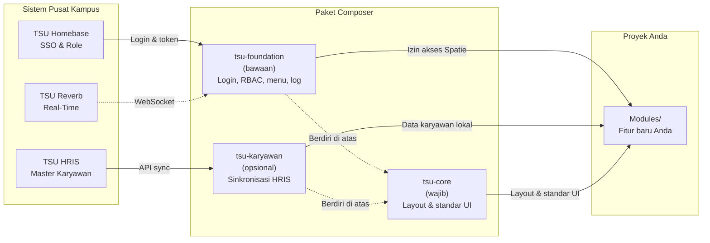

### Filosofi Arsitektur: Modular Monolith <!-- id: mulai-filosofi; icon: fas fa-cube; short: Filosofi Arsitektur -->

Template ini dibangun menggunakan pendekatan **Monolith Modular** berbasis framework Laravel. Setiap domain aplikasi dipecah menjadi modul mandiri di dalam direktori `sources/Modules/` dengan pemisahan Controller, View, Route, dan Model yang jelas.

Pendekatan ini memungkinkan tim atau mahasiswa bekerja secara paralel di modul masing-masing tanpa saling menimpa (*merge conflict*) file route atau controller utama. Modul juga dapat dipindahkan atau dipaketkan ke modul lain secara mandiri.



*Keterangan Diagram:*
* **Sistem Pusat Kampus:** Layanan terpusat universitas (*TSU Homebase, TSU HRIS, TSU Reverb*) yang berada di luar proyek Anda.
* **Paket Composer** (di `vendor/pikdi`, jangan diubah)**:** `tsu-core` wajib dan tidak bergantung pada paket lain. `tsu-foundation` dan `tsu-karyawan` berdiri di atas core. Tanpa `tsu-foundation`, aplikasi tetap jalan tetapi tanpa login dan menu dinamis. `tsu-karyawan` boleh tidak dipasang.
* **Proyek Anda** (starter kit ini)**:** Hanya folder `Modules/` (dan konfigurasi proyek) yang Anda kerjakan. Isi `vendor/pikdi/` jangan diubah.

---

### Prasyarat Lingkungan Pengembangan <!-- id: mulai-prasyarat; icon: fas fa-server; short: Prasyarat Sistem -->

Sebelum menjalankan aplikasi di komputer lokal Anda, pastikan sistem telah terpasang:
* **PHP:** Versi `>= 8.3` (template memakai Laravel 13) (Ekstensi aktif: `pdo_mysql`, `mbstring`, `openssl`, `curl`, `bcmath`, `gd`, `zip`).
* **Web Server & Database:** Disarankan menggunakan **Laragon** (Windows) atau Docker/Valet (Linux/macOS) dengan MariaDB 10.4+ / MySQL 8.0+.
* **Composer:** Composer versi 2.x.
* **Node.js & NPM:** Node.js LTS (v18.x atau v20.x).

---

### Langkah Instalasi Pertama Kali (5 Langkah Cepat) <!-- id: mulai-instalasi; icon: fas fa-download; short: Instalasi Pertama Kali -->

Ikuti 5 langkah instalasi cepat ini setelah melakukan kloning repositori:

#### Langkah 0: Akses Paket TSU (sekali per pengembang)
Paket inti (`pikdi/tsu-core`, `pikdi/tsu-foundation`, `pikdi/tsu-karyawan`) berada di **repositori GitHub privat PIKDI** dan diunduh Composer lewat `git`.
1. **Minta akses ke PIKDI** (WhatsApp Helpdesk [**+62 851-1141-5175**](https://wa.me/6285111415175?text=Halo%20Helpdesk%20PIKDI%20TSU%2C%20saya%20membutuhkan%20bantuan%20teknis%20terkait%20aplikasi%20di%20lingkungan%20TSU.) atau [**pikdi@tsu.ac.id**](mailto:pikdi@tsu.ac.id)) dengan menyebutkan akun GitHub Anda. PIKDI mengundang Anda ke repo paket dengan hak *Read* (hanya boleh mengunduh) selama masa penugasan, dan mencabutnya setelah selesai. **Terima undangan** yang dikirim GitHub ke email Anda, atau buka github.com/notifications.
2. **Pastikan `git` bisa mengakses GitHub dengan akun tersebut**, misalnya lewat GitHub Desktop atau Git Credential Manager (bawaan Git for Windows): uji dengan
   ```bash
   git ls-remote https://github.com/PIKDI-TIGA-SERANGKAI-UNIVERSITY/tsu-core.git
   ```
   Bila diminta login, masuk dengan akun GitHub yang sudah diberi akses. Tidak perlu token API Composer.
   **Windows:** aktifkan dukungan path panjang agar paket tidak gagal dipasang (*Filename too long*) bila folder proyek berada cukup dalam:
   ```bash
   git config --global core.longpaths true
   ```
3. **Jangan membagikan** login/token GitHub Anda ke orang lain. Akses bersifat pribadi agar aktivitas pengembangan dapat ditelusuri.

> **Laptop Anda tidak butuh token atau `auth.json`.** Cukup akun GitHub yang sudah diberi akses dan sudah login di Git. Token hanya dipakai **server** (staging/production) dan diurus PIKDI dengan akun mesin; berkas `auth.json` berisi rahasia dan tidak boleh di-commit.

#### Langkah 1: Salin Environment & Konfigurasi Database
```bash
# Masuk ke folder sources
cd tsu-project-template/sources
cp .env.example .env
```
Buka file `.env`, lalu sesuaikan koneksi database Anda:
```dotenv
APP_NAME="TSU Modul Perpustakaan"
APP_URL="http://tsu-project-template.test"
DB_CONNECTION=mysql
DB_HOST=127.0.0.1
DB_PORT=3306
DB_DATABASE=tsu_perpustakaan
DB_USERNAME=root
DB_PASSWORD=
```

#### Langkah 2: Pasang Dependensi Composer & NPM
```bash
composer install
npm install
```
`composer install` memasang kombinasi **bawaan**: `pikdi/tsu-core` (wajib) dan `pikdi/tsu-foundation` (login, role, menu, log). Paket opsional `pikdi/tsu-karyawan` (data dosen & tendik dari HRIS) **tidak** ikut terpasang otomatis, tambahkan sendiri bila dibutuhkan:
```bash
composer require pikdi/tsu-karyawan:dev-main
php artisan migrate --seed
```
`--seed` wajib diulang di sini agar menu **Data Karyawan** langsung tampil (dipasang otomatis oleh `DatabaseSeeder`, aman dijalankan berulang). Menu baru muncul bila `FEATURE_DATA_KARYAWAN=true` **dan** `HRIS_SYNC_SECRET` sudah sah terisi di `.env`. Lihat [Kombinasi Paket yang Didukung](#mulai-kombinasi-paket) untuk pilihan lain (mis. tanpa `tsu-foundation`).

> Template tidak menyertakan `composer.lock`. Setelah `composer install` pertama pada repo **proyek** Anda, berkas `sources/composer.lock` muncul: **commit berkas itu** agar seluruh anggota tim dan server memakai versi paket yang sama. Memperbarui paket nanti (termasuk setelah `composer require` di atas): `composer update "pikdi/*"`, lalu commit `composer.lock` yang berubah.

#### Langkah 3: Generate Key & Jalankan Migrasi Database Awal
```bash
php artisan key:generate
php artisan migrate --seed
```
Opsi `--seed` mengisi data awal: role, izin, dan menu sidebar. Tanpa itu aplikasi tetap berjalan, tetapi menu dan hak akses kosong (perbaiki dengan `php artisan db:seed`). Modul `Admin` sudah aktif sejak awal (`modules_statuses.json`), jadi tidak perlu `module:enable`.

> **Bila Anda membuka aplikasi sebelum langkah-langkah di atas selesai, aplikasi sendiri yang memandu.** Pertama muncul halaman **"Instalasi belum selesai"** (dependensi, berkas `.env`, atau `APP_KEY` belum siap). Setelah itu, bila database belum siap, muncul halaman **error database** yang menjelaskan penyebabnya: contoh isian `.env` (`DB_*`), cara membuat database, dan perintah `php artisan migrate --seed`, semuanya dengan tombol **Salin**. Halaman error database lengkap dengan perintah hanya tampil saat `APP_DEBUG=true`.

#### Langkah 4: Jalankan Server Lokal
Buka folder proyek lewat web server dengan **document root di folder repo** (bukan `public/`). Tiga cara yang didukung, lengkap dengan langkah, cara memeriksa, dan masalah umum, ada di bagian [Menjalankan Aplikasi di Komputer Lokal](#mulai-server-lokal): virtual host `.test` (disarankan di Windows), `http://localhost/nama-proyek`, atau `php artisan serve` (tanpa Laragon, cocok untuk Linux dan macOS).

#### Langkah 5: Login Akun Pengembang Cadangan (Offline Mode)
Akun developer lokal **tidak dibuat otomatis** oleh `migrate --seed`. Jika diperlukan, buat secara manual (**hanya berjalan pada `APP_ENV=local`**, ditolak di staging/production; membutuhkan paket `pikdi/tsu-foundation` yang terpasang secara default):
```bash
php artisan db:seed --class=DevAdminSeeder
```
Lalu buka halaman `/login`. Karena berjalan di mode lokal (`APP_ENV=local`), Anda dapat masuk tanpa internet menggunakan kredensial dev:
* **Username/Email:** `devadmin` atau `dev.admin@tsu.ac.id`
* **Password:** `password@123` (atau disesuaikan di `DEV_ADMIN_PASSWORD` pada `.env`)

---

### Kombinasi Paket yang Didukung <!-- id: mulai-kombinasi-paket; icon: fas fa-boxes-stacked; short: Kombinasi Paket; keywords: tsu-karyawan, tsu-foundation, composer require, opsional, hris -->

`pikdi/tsu-core` **wajib** dan tidak bergantung paket TSU lain. `pikdi/tsu-foundation` dan `pikdi/tsu-karyawan` berdiri di atasnya dan boleh dikombinasikan sesuai kebutuhan proyek:

| Kombinasi | Cara memasang | Hasil |
|---|---|---|
| **Default** (tsu-core + tsu-foundation) | `composer install` | Login TSU (SSO & lokal), manajemen user/role/menu, log, notifikasi |
| + Data Karyawan | `composer require pikdi/tsu-karyawan:dev-main`, lalu `php artisan migrate --seed` (menu tampil bila `FEATURE_DATA_KARYAWAN=true` dan `HRIS_SYNC_SECRET` sah) | Menu **Data Karyawan** & sinkronisasi HRIS (lihat [Modul Data Karyawan (HRIS Sync)](#karyawan-hris-sync), muncul di `/panduan` setelah paket terpasang) |
| + Data Karyawan, tanpa foundation | `composer remove pikdi/tsu-foundation`, lalu `composer require pikdi/tsu-karyawan:dev-main` dan `php artisan migrate` (menu tampil bila `FEATURE_DATA_KARYAWAN=true` dan `HRIS_SYNC_SECRET` sah) | Menu Data Karyawan lewat slot sidebar tsu-core, tanpa login/role/menu dinamis |
| Tanpa login TSU (tsu-core saja) | `composer remove pikdi/tsu-foundation` | Landing page, panduan, dashboard & layout TSU tetap jalan; `/login` menampilkan panduan memasang autentikasi sendiri; sidebar memakai menu statis (`resources/views/partials/sidebar-menu.blade.php`) |

Setelah mengubah kombinasi, jalankan `composer update "pikdi/*"` lalu commit `composer.lock` yang berubah (lihat catatan di Langkah 2). Paket yang baru dipasang menambahkan bab panduannya sendiri ke `/panduan` secara otomatis.

---

### Menjalankan Aplikasi di Komputer Lokal (`.test` atau `localhost`) <!-- id: mulai-server-lokal; icon: fas fa-desktop; short: Menjalankan di Lokal; keywords: laragon, xampp, localhost, virtual host, document root, index of, apache, mod_rewrite, htaccess, session cookie -->

Template ini punya susunan khusus: `index.php` berada di **folder repo** dan folder `public/` hanya berisi aset. Karena itu web server harus memakai **folder repo sebagai document root**, bukan `public/`. Ada tiga cara yang didukung:

| Cara | Alamat | Kapan dipakai |
|---|---|---|
| **A. Virtual host `.test`** (disarankan) | `http://nama-proyek.test` | Paling mirip dengan server asli, alamat tanpa awalan folder |
| **B. Subfolder `localhost`** | `http://localhost/nama-proyek` | Cepat, tanpa menyiapkan virtual host |
| **C. `php artisan serve`** | `http://127.0.0.1:8000` | Tanpa Laragon atau Apache, cocok untuk Linux dan macOS. Hanya untuk pengembangan |

Cara A dan B membutuhkan Apache dengan `mod_rewrite` aktif dan `AllowOverride All` (bawaan Laragon, umumnya juga bawaan XAMPP). Cara C hanya membutuhkan PHP.

**Cara A: virtual host `.test` (Laragon)**
1. Letakkan folder proyek di folder `www` Laragon, misalnya `D:\laragon\www\nama-proyek`.
2. Pastikan fitur *Auto virtual hosts* Laragon aktif (Menu > Preferences > General, nama menu dapat berbeda antar versi), lalu klik kanan ikon Laragon dan pilih *Reload*. Laragon membuat berkas `auto.nama-proyek.test.conf` dan menambahkan nama itu ke berkas `hosts`. Jalankan Laragon sebagai **Administrator** bila nama `.test` tidak dikenali.
3. Laragon menemukan folder `public/` dan **otomatis memakainya sebagai document root**. Itu salah untuk template ini: browser akan menampilkan "Index of /" berisi `assets/`, `favicon.ico`, `robots.txt`, dan `web.config`. Perbaiki sekali per proyek:
   * Buka `laragon\etc\apache2\sites-enabled\auto.nama-proyek.test.conf` (di Laragon: klik kanan ikon > Apache > sites-enabled).
   * Ubah baris pertama dari `define ROOT "D:/laragon/www/nama-proyek/public"` menjadi
     ```text
     define ROOT "D:/laragon/www/nama-proyek"
     ```
   * Simpan, lalu **Reload atau Restart Apache**.
4. Di `.env` isi `APP_URL=http://nama-proyek.test` dan `SESSION_COOKIE` yang unik (misal `lppm_session`).
5. Buka `http://nama-proyek.test`.

**Cara B: subfolder `localhost`**
1. Letakkan folder proyek di folder web server: `www` pada Laragon atau `htdocs` pada XAMPP.
2. Pastikan `mod_rewrite` aktif dan folder itu mengizinkan `AllowOverride All` (jika tidak, berkas `.htaccess` di akar repo diabaikan dan semua alamat selain beranda memberi 404 bawaan Apache).
3. Di `.env` isi `APP_URL=http://localhost/nama-proyek` (agar alamat di email dan perintah artisan benar) dan **`SESSION_COOKIE` yang unik per proyek**. Semua proyek di `localhost` berbagi satu tempat cookie browser, sehingga tanpa ini login satu proyek bisa menimpa proyek lain.
4. Buka `http://localhost/nama-proyek`. Template sudah diuji dari subfolder: halaman, aset, dan tautan otomatis memakai awalan `/nama-proyek`.
5. Login SSO butuh alamat callback yang terdaftar di TSU Homebase. Untuk `http://localhost/nama-proyek` PIKDI perlu mendaftarkannya (bab Autentikasi, "Meminta Akses SSO ke PIKDI"). Selama belum, masuk dengan akun developer lokal (Langkah 5).

**Cara C: `php artisan serve` (tanpa Laragon, cocok untuk Linux dan macOS)**
1. Dari folder `sources`, jalankan:
   ```bash
   php artisan serve
   ```
2. Buka `http://127.0.0.1:8000`. Bila port 8000 sudah dipakai, jalankan `php artisan serve --port=8001`.
3. Di `.env` isi `APP_URL=http://127.0.0.1:8000` (sesuaikan port) dan `SESSION_COOKIE` yang unik.
4. Hentikan server dengan `Ctrl+C`.

Catatan Cara C:
* Template memakai perintah `serve` dan router (`sources/server.php`) khusus, karena `index.php` berada di akar repo. Aturan keamanannya sama dengan `.htaccess`: berkas di luar `public/` (termasuk `.env` dan `sources/`) ditolak.
* Server bawaan PHP **hanya untuk pengembangan** dan melayani satu permintaan sekali waktu, sehingga halaman dengan banyak aset bisa terasa sedikit lebih lambat. Jangan dibuka ke jaringan publik (`--host=0.0.0.0`).
* Login SSO butuh callback yang terdaftar di Homebase untuk alamat itu (bab Autentikasi, "Meminta Akses SSO ke PIKDI"). Selama belum, pakai akun developer lokal (Langkah 5).

**Pastikan berhasil** (ganti alamat sesuai cara yang dipakai):
* [ ] `/` menampilkan halaman beranda TSU (bukan daftar berkas atau halaman Apache).
* [ ] `/panduan` terbuka dan memuat bab-bab panduan.
* [ ] `/login` menampilkan halaman login (atau panduan memasang login bila `tsu-foundation` dilepas).
* [ ] Tampilan memakai warna dan ikon TSU (aset termuat). Bila polos tanpa gaya, periksa bagian masalah umum di bawah.
* [ ] Setelah login lokal, `/admin/dashboard` terbuka.

**Masalah umum**

| Gejala | Penyebab | Cara memperbaiki |
|---|---|---|
| Halaman "Instalasi belum selesai" | `composer install`, berkas `.env`, atau `APP_KEY` belum disiapkan | Jalankan langkah bertanda *Perlu dilakukan* di halaman itu secara berurutan, lalu muat ulang. `php artisan` tanpa `vendor` juga menyebut langkah yang kurang |
| "Index of /" berisi `assets/`, `favicon.ico`, `robots.txt`, `web.config` | Document root masih `public/` (Cara A) | Ubah `define ROOT` seperti langkah 3 Cara A, lalu Reload Apache |
| `.test` tidak dikenali (*This site can't be reached* / `ERR_NAME_NOT_RESOLVED`) | Nama belum masuk berkas `hosts` | Jalankan Laragon sebagai Administrator, pastikan *Auto virtual hosts* aktif, lalu Reload |
| Alamat `localhost/nama-proyek` memberi 404 bawaan Apache di semua halaman selain beranda | `.htaccess` tidak terbaca (`mod_rewrite` mati atau `AllowOverride None`) | Aktifkan `mod_rewrite`, atur `AllowOverride All` untuk folder itu, restart Apache |
| 404 "Not Found" atau "Object not found" di `localhost` | Nama folder di alamat tidak sama dengan nama folder sebenarnya, atau folder di luar `www`/`htdocs` | Samakan penulisan nama folder dan lokasinya |
| 403 Forbidden saat membuka `/sources/...`, `/.env`, atau `/README.md` | Disengaja: hanya `index.php` dan `public/` yang boleh diakses dari web | Tidak perlu diperbaiki |
| Error 500 "No application encryption key has been specified" | `APP_KEY` belum dibuat | `php artisan key:generate` lalu `php artisan config:clear` |
| Error "Unsupported cipher or incorrect key length" | `APP_KEY` masih berisi teks contoh dari `.env.example` (`HAPUS_KALIMAT_INI_...`) atau bukan kunci yang sah | `php artisan key:generate` (mengganti teks contoh dengan kunci baru) lalu `php artisan config:clear` |
| Error 500 atau "SQLSTATE ... connection refused / access denied / unknown database" | Pengaturan `DB_*` salah atau database belum dibuat | Perbaiki `DB_*` di `.env`, pastikan database ada, lalu `php artisan config:clear`. Halaman error menampilkan contoh isian `.env` yang bisa disalin (pada Laragon: `DB_USERNAME=root`, `DB_PASSWORD` kosong) |
| Error database menyebut host atau nama database `MASUKKAN_...` (mis. `MASUKKAN_KONEKSI_HOST_DATABASE`) | `.env` disalin dari `.env.example` tetapi nilai `DB_*` masih teks contoh | Ganti seluruh `DB_*` dengan nilai sebenarnya, lalu `php artisan config:clear` |
| Klik login SSO muncul halaman "Login SSO Belum Dikonfigurasi" | `TSU_SSO_*` di `.env` kosong atau masih teks contoh. Akses Anda tidak diblokir | Ikuti halaman itu: salin URL callback, kirim permintaan ke Helpdesk PIKDI (tombol WhatsApp/Email), isi `.env`, lalu `php artisan config:clear`. Detail: bab Autentikasi, "Meminta Akses SSO ke PIKDI" |
| Homebase menampilkan "Akses aplikasi ini telah DIBEKUKAN atau DICABUT" | Client ID salah/belum terdaftar, atau URL callback belum terdaftar untuk alamat yang Anda buka | Cocokkan `TSU_SSO_CLIENT_ID` dan `TSU_SSO_REDIRECT_URI` dengan yang dikirim PIKDI, dan buka aplikasi dari alamat callback itu. Bila sudah sesuai, hubungi Helpdesk PIKDI dengan menyebutkan URL callback Anda |
| Perubahan `.env` tidak berpengaruh | Konfigurasi masih tersimpan di cache | `php artisan config:clear` |
| Tiba-tiba logout sendiri atau login proyek lain terbawa | Beberapa proyek di `localhost` memakai nama cookie sesi yang sama | Isi `SESSION_COOKIE` unik per proyek, lalu hapus cookie `localhost` di browser |
| Peringatan sertifikat pada `https://nama-proyek.test` | Sertifikat Laragon belum dipercaya browser | Pakai `http://`, atau percayai sertifikat Laragon |
| `php artisan serve` error "provided cwd ... sources\public does not exist" | Versi template lama yang belum memiliki perintah `serve` khusus | Perbarui dari template terbaru (`sources/app/Console/Commands/ServeCommand.php` dan `sources/server.php`), atau pakai Cara A atau B |
| `php artisan serve`: "Failed to listen on 127.0.0.1:8000" | Port sudah dipakai program lain | `php artisan serve --port=8001` |

---

### Memahami Feature Flags & Pengaturan Modul di File .env <!-- id: mulai-feature-flags; icon: fas fa-toggle-on; short: Feature Flags Utama -->

Template dilengkapi dengan pengaturan identitas modul dan tombol saklar (*feature flags*) agar Anda bisa mengaktifkan/menonaktifkan modul demo tanpa merusak kode:

| Variable di .env | Default | Penjelasan Fungsi & Dampak |
|---|---|---|
| `MODULE_FULL_NAME` | `tsu_template` | Nama lengkap modul aplikasi (format snake_case / teks bebas). Nilai ini otomatis diformat rapi tanpa simbol dan berformat Title Case di seluruh UI via helper `tsu_module_title()`. |
| `MODULE_NAME` | `template` | Prefix nama modul untuk tabel database Spatie permission dan namespace sistem internal (huruf kecil). |
| `MODULE_TITLE_ACRONYMS` | `TSU,SSO,API,HRIS,PIKDI,SIAKAD,SIM` | Daftar singkatan yang otomatis dijadikan **UPPERCASE** pada judul modul di antarmuka (pisahkan dengan koma). Bebas ditambahkan sesuai kebutuhan domain (misal: `PMB,LPM,BPM`). |
| `FEATURE_DEMO_DASHBOARD` | `true` | Jika `true`, dashboard admin menampilkan kartu metrik dan grafik demo. Jika disetel `false`, dashboard langsung beralih ke kanvas kosong bersih (`blank.blade.php`) untuk Anda bangun sendiri. |
| `FEATURE_DEMO_LANDING_PAGE` | `true` | Jika `true`, halaman depan (`/`) menampilkan showcase fitur resmi TSU. Jika disetel `false`, beralih ke kanvas landing page bersih (`resources/views/landing/blank.blade.php`). |
| `FEATURE_MANUAL_BOOK` | `true` | Jika `true`, seluruh buku panduan (rute `/panduan`) dan tombol bantuan dapat diakses. **Saat aplikasi siap rilis ke Production, ubah ke `false`** untuk menyembunyikan dokumentasi secara otomatis. |
| `FEATURE_WELCOME_SPLASH` | `true` | Jika `true`, menampilkan layar transisi sambutan (*Welcome Splash*) elegan 1x pasca-login dengan animasi logo TSU berdenyut dan adaptif terhadap koneksi internet lambat. |
| `FEATURE_TOP_PROGRESS_BAR` | `true` | Jika `true`, mengaktifkan indikator garis progress tipis 3px ala GitHub/YouTube di bagian paling atas layar saat navigasi antar rute atau AJAX. |
| `FEATURE_DATA_KARYAWAN` | `false` | Modul data dosen & tendik dari HRIS pusat (paket opsional `pikdi/tsu-karyawan`, lihat [Modul Data Karyawan (HRIS Sync)](#karyawan-hris-sync)). Hanya diaktifkan menjadi `true` jika modul Anda membutuhkan data pegawai dan telah diberi kunci `HRIS_SYNC_SECRET` sah oleh PIKDI. |
| `TSU_HOME_ROUTE` | `admin.dashboard` | Nama route "beranda" setelah login dan untuk tombol kembali (halaman error, logo sidebar). Jika route tidak terdaftar, otomatis memakai `/`. |

> [!NOTE]
> **Pembatasan Akses Modul Dinamis (`APP_ALLOWED_ROLES`):**
> Atur variabel `APP_ALLOWED_ROLES="dosen,tendik"` atau `"dosen,tendik,magang"` di file `.env` untuk membatasi kelompok pengguna yang diizinkan masuk ke aplikasi. Halaman login otomatis membaca nilai ini via helper `tsu_allowed_roles_text()` dan menampilkannya secara dinamis pada badge informasi portal login. Kosongkan nilai jika seluruh sivitas kampus diizinkan mengakses modul.

---

### Untuk Pengembang Paket TSU (khusus tim PIKDI) <!-- id: mulai-pengembang-paket; icon: fas fa-code-branch; short: Untuk Pengembang Paket -->

Pengembang biasa **tidak perlu** bagian ini: paket TSU terpasang otomatis dari GitHub lewat `composer install`. Bagian ini hanya untuk tim PIKDI yang mengubah paket sekaligus mencobanya di template:

1. Letakkan folder `tsu-core`, `tsu-foundation`, dan `tsu-karyawan` bersebelahan dengan `tsu-project-template`.
2. Salin `sources/composer.local.json.example` menjadi `sources/composer.local.json` (tidak di-commit).
3. Pada clone yang baru, jalankan `composer install` lebih dulu (memasang plugin yang membaca `composer.local.json`), lalu `composer update "pikdi/*"`. Paket terpasang sebagai *symlink* ke folder lokal, bukan dari GitHub. Tanpa `composer install` lebih dulu, berkas lokal diabaikan dan paket tetap diambil dari GitHub.
4. Periksa dengan `ls -la vendor/pikdi`: setiap paket harus berupa tautan ke folder lokal.
